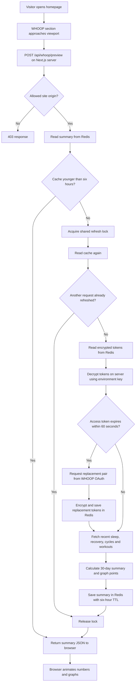
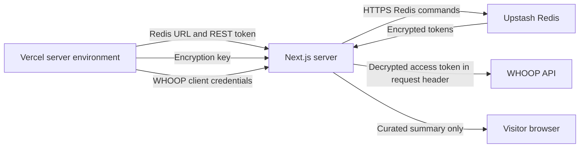

# WHOOP statistics: architecture and Redis flow

The homepage displays one owner's rolling 30-day WHOOP summary. A Next.js server on Vercel reads that summary from Upstash Redis. When the six-hour cache expires, a visitor's request triggers a fresh WHOOP fetch. Credentials and token operations stay on the server.

## Why these services?

| Component | Why we use it |
| --- | --- |
| WHOOP API | Source of sleep, recovery, cycle strain, and workout records. The API returns data already synced and processed by WHOOP. |
| Next.js on Vercel | Runs the server API that handles credentials, calculates the summary, and serves it to the browser. |
| Redis | Shares changing tokens and cached summaries across server instances. TTL expires cached summaries, and atomic commands coordinate refreshes. |
| Upstash | Hosts Redis and provides an HTTPS REST interface that our server calls with native `fetch`; we do not manage a Redis server or connection pool. We selected a Free database with Mumbai as its primary region and eviction disabled. |
| Vercel environment variables | Store fixed configuration and secrets. They are suitable for client credentials and the encryption key; rotating WHOOP tokens need writable storage. |

Vercel instances can restart or run concurrently. Local files and module memory cannot provide shared, persistent production storage. The six-hour cache also avoids fetching and paginating four WHOOP collections on every visit. Upstash's Free plan was selected for this small workload; that choice does not guarantee permanent free pricing or unlimited usage.

## Overall flow



The lock covers refresh work and is released in a `finally` block, including when work fails. Cache hits do not acquire it. A request that waits for the lock rechecks the summary before fetching WHOOP.

## What is stored?

| Redis key | Stored value | Lifetime |
| --- | --- | --- |
| `whoop:owner:tokens:v1` | AES-256-GCM encrypted JSON containing `access_token`, `refresh_token`, `scope`, and `expires_at`. The outer JSON has `v`, `iv`, `tag`, and `body`. | No Redis TTL. The pair is replaced on refresh. WHOOP still controls token validity. |
| `whoop:owner:preview:v1` | Readable JSON containing `{ v: 1, cachedAt, data }`. `data` is the curated homepage summary. | `EX 21600`: six hours from a successful cache write. |
| `whoop:owner:lock:v1` | Random owner identifier for the server request holding the lock. | Two-minute lease, renewed every 30 seconds while running; normally removed when work finishes. |

The summary includes `syncedAt`, period dates, averages, sample counts, 30-day sleep/recovery/strain graph points, tracked-day activity summaries, workout-day count, and session count. It does not contain credentials or raw WHOOP API records. The summary is deliberately readable JSON; token encryption does not encrypt this separate cache entry.

Dates use Asia/Kolkata. Non-nap scored sleep supplies sleep averages; recovery is matched to the sleep cycle. Completed cycles supply the average strain. Ongoing strain can appear in the graph with `ongoing: true`, but is excluded from the completed-day average. Missing values remain `null`, rather than becoming zero. The server fetches a 32-day window to build the displayed 30-day period.

## Refresh scenarios

| Scenario | Behavior |
| --- | --- |
| Cache exists and is fresh | Return it directly from Redis without calling WHOOP. |
| Cache missing or expired | Acquire the lock, fetch WHOOP, calculate the summary, and save it for six hours. |
| Multiple simultaneous misses | One request refreshes; waiting requests recheck and reuse the saved result. Lock acquisition times out after approximately 15 seconds if it stays busy. |
| Access token approaching expiry | Use the refresh token and app credentials to obtain a replacement pair. Save it encrypted before requesting records. |
| Failed WHOOP request | Do not save a new summary. Return 503 and let the UI show its retry action. No stale-summary fallback is currently implemented. |
| Redis unavailable or partially configured | Fail rather than silently using a local file in production. |
| No Redis configured in development | Use local token files and a six-hour memory cache. |
| No visitors for a day | Redis expires the summary; the next visitor triggers a refresh. There is no scheduled sync or WHOOP webhook integration. |

Example: a successful fetch at 10 AM caches the summary until 4 PM. Visitors at 11 AM and 3 PM reuse it. If the next visitor arrives at 4:15 PM, that request refreshes the data and starts a new six-hour TTL. Reading the cache does not extend its expiry. Current-day values may change at WHOOP during the cache window.

## Credentials and access boundaries



Required server variables:

| Variable | Purpose |
| --- | --- |
| `UPSTASH_REDIS_REST_URL` | Redis REST endpoint. |
| `UPSTASH_REDIS_REST_TOKEN` | Authorizes Redis reads and writes. |
| `WHOOP_TOKEN_ENCRYPTION_KEY` | Base64-encoded 32-byte key used locally on the server to encrypt/decrypt tokens. It is not sent to Redis. |
| `WHOOP_CLIENT_ID` | WHOOP application identifier. |
| `WHOOP_CLIENT_SECRET` | Authenticates token exchange and renewal. |
| `WHOOP_REDIRECT_URI` | Registered callback URL for connection/reconnection. Production value: `https://www.rohangore.com/api/whoop/callback`. |

Use the same encryption key locally and on Vercel so both can read the existing encrypted record. Replacing the key requires re-encrypting that record or reconnecting. Add environment values through Vercel settings and redeploy. None of the six variables uses `NEXT_PUBLIC_`. `.env.local` and `.whoop/` are ignored by Git. `NEXT_PUBLIC_SITE_URL` is separate, optional public site configuration.

The summary endpoint is intended to be public. It checks the configured site origin and accepts both `https://www.rohangore.com` and `https://rohangore.com`; local development accepts its loopback origin. An origin check is not owner authentication: callers outside a browser can supply that header. The endpoint therefore returns only the curated public summary.

OAuth setup, connect, callback, and token-test routes remain restricted to local development and return 404 in production. Reconnecting on production will require an authenticated owner flow. Browser Network tools show calls to the website and the returned summary; they do not show the server's WHOOP authorization header or Redis credentials.

## Code map

| File | Responsibility |
| --- | --- |
| `src/app/page.js` / `src/app/HomeClient.jsx` | Include the WHOOP section on the homepage. |
| `src/components/home/WhoopPreview.jsx` | Fetch the summary when visible and display animated metrics. |
| `src/app/api/whoop/preview/route.js` | Validate origin, call the cache loader, and return JSON or a generic error. Browser/CDN responses use `Cache-Control: no-store`; Redis supplies the six-hour cache. |
| `src/lib/whoop-cache.mjs` | Check freshness, serve hits, and double-check misses under the refresh lock. |
| `src/lib/whoop-redis.mjs` | HTTPS Redis commands, encryption, token storage, summary TTL, and distributed lock ownership. |
| `src/lib/whoop.mjs` | OAuth configuration, token exchange, storage selection, and serialized connection operations. |
| `src/lib/whoop-preview.mjs` | Paginated WHOOP reads and 30-day summary calculation. |
| `scripts/whoop-migrate-redis.mjs` | Transfer and verify the existing local token pair without overwriting an existing Redis connection. |

Redis writes use Lua ownership checks so only the current lock owner can save tokens or a summary. Release and renewal also verify ownership. Tokens have no cache expiry; changing the summary TTL does not affect them.

## Verification

The current backend/visual helper suite passed 27 tests. Live storage checks verified token rotation persistence, six-hour summary TTL, and cache reuse from a fresh process without a WHOOP request. An isolated production build verified the homepage section, successful Redis summaries for both domain forms, rejection of an unapproved origin, and 404 responses from all administrative routes.

Run the focused suite with:

```sh
node --test scripts/whoop-cache.test.mjs scripts/whoop-redis.test.mjs scripts/whoop.test.mjs scripts/whoop-preview.test.mjs scripts/whoop-visuals.test.mjs
```

See [WHOOP setup](./whoop-setup.md) for configuration and migration instructions.
